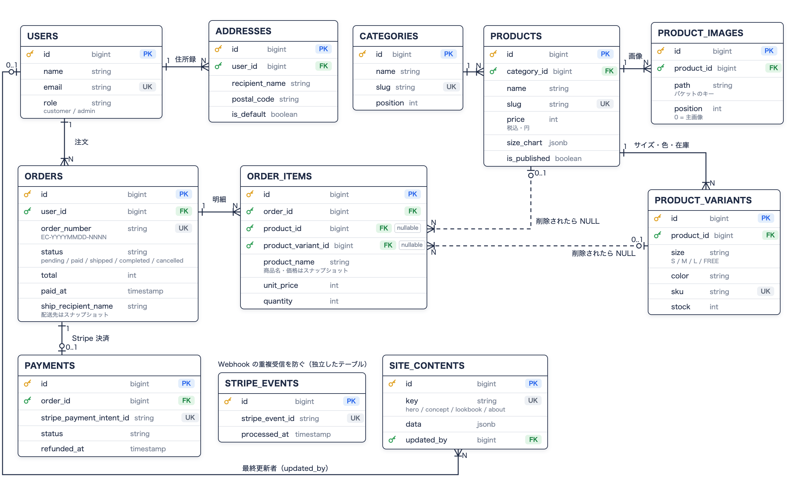

# EC-Portfolio

Laravel + Next.js 構成の、架空のミニマルなアパレルブランドの EC サイトです。カタログからカート、Stripe での決済、管理画面（売上ダッシュボード・CMS）まで動きます。

## デモ

- ストア: https://frontend-production-e5f4e.up.railway.app

決済は Stripe のテストモードです。テストカード `4242 4242 4242 4242`（有効期限は未来の日付、CVC は任意）で購入まで試せます。

## ER図



## 主な機能

**ストア**

- 商品一覧・商品詳細（カテゴリ、色・サイズの選択、在庫表示、サイズ表）
- カート（ログイン不要。ブラウザに保存し、カートとチェックアウトで在庫・価格を再確認）
- 会員登録・ログイン・パスワードリセット（ログイン試行のレート制限つき）
- チェックアウト（住所録から選択 or 新しい住所）と Stripe 決済（Payment Element）
- マイページ（注文履歴・住所録・プロフィール・パスワード変更）
- 注文確認・発送通知・パスワードリセットのメール（キューで非同期送信）

**管理画面**

- 運用ダッシュボード（未発送・受け取り待ち・在庫わずか・売り切れの件数と、未発送の注文一覧）
- 売上ダッシュボード（今月の KPI、日別⇔月別の棒グラフ、カテゴリ別の商品ランキングと前月比。グラフの棒から月を選べる）
- 商品（画像・サイズ / 色 / 在庫）・カテゴリの管理
- 注文のステータス変更（発送・完了・キャンセル。支払い済みのキャンセルは Stripe で自動返金）
- 会員一覧・会員ごとの注文履歴
- トップページの CMS（Hero / Concept / Lookbook / About）

**裏側**

- 決済の確定は Stripe の Webhook だけで行う（署名検証・重複受信の防止つき）
- 30 分支払いのない注文は、スケジューラが自動でキャンセルして在庫を戻す
- カタログとトップページは ISR でキャッシュし、管理画面で更新したら即時に再検証

意図的にスコープ外にしたもの: お気に入り、検索、レビュー、クーポン、ゲスト購入、カード以外の決済手段、メールアドレスの確認、独自ドメイン（メールは Resend の共有ドメインから送るため、アカウント所有者のアドレスにしか届きません）

## 技術スタック

| 層             | 技術                                                                                                                                                        |
| -------------- | ----------------------------------------------------------------------------------------------------------------------------------------------------------- |
| バックエンド   | Laravel 12 / PHP 8.4 / Laravel Sanctum（トークン認証）/ PostgreSQL / stripe-php / Pest / Laravel Pint                                                       |
| フロントエンド | Next.js 15（App Router）/ React 19 / TypeScript / Tailwind CSS v4 / Zustand / TanStack Query / react-hook-form + zod / Stripe.js / Vitest + Testing Library |
| 決済・メール   | Stripe（テストモード、Payment Element + Webhook）/ Resend（本番）/ Mailpit（ローカル）                                                                      |
| ストレージ     | Railway Buckets（S3 互換。Next.js の `/media` 経由で配信）/ RustFS（ローカル）                                                                              |
| インフラ       | Railway（Dockerfile ビルド、GitHub 連携による自動デプロイ）/ Docker Compose（ローカル）/ GitHub Actions（CI）                                               |

## アーキテクチャ

```
backend/    Laravel — ビューを持たない JSON API（+ queue / scheduler）
frontend/   Next.js（App Router）— 画面と BFF
docs/       設計ドキュメント（API・DB・決済・管理画面など）と作業ログ
docker-compose.yml  ローカル開発用
```

- **BFF 構成**: ブラウザが話すのは Next.js だけ。ログインすると Laravel のトークンを httpOnly Cookie に入れ、Next.js の Route Handler（`/bff/*`）と Server Component がそのトークンで Laravel を呼ぶ。トークンがブラウザの JavaScript から見えないので、XSS で盗まれない。
- **Server Component が基本**: ページとレイアウトはすべて Server Component。Client Component はボタンやフォームなど、操作がある部品だけ。管理画面の更新のあとは `router.refresh()` で描き直す。
- **ISR + `revalidateTag`**: 商品・カテゴリ・トップページはタグ付きでキャッシュし、管理画面で更新したら BFF がそのタグだけを無効化する（商品の slug を変えたときは、古い URL のキャッシュも消す）。
- **決済**: 注文を作った時点で在庫を確保し、PaymentIntent を作成。支払いの成功は Webhook（`payment_intent.succeeded`）で受けて `paid` にする。完了画面はステータスをポーリングして表示する。
- **注文ステータス**: `pending → paid → shipped → completed`（どこからでも `cancelled`）。許されない遷移は 422。
- **日本時間の扱い**: DB は UTC。売上の集計は日本時間の期間（`[月初, 翌月初)`）を UTC に直して絞り込み、日・月ごとのまとめは SQL で日本時間に変換してから行う。
- **非同期処理**: メール送信はキュー（`database` ドライバ）の worker、期限切れ注文のキャンセルは scheduler。どちらも backend と同じイメージを起動コマンドだけ変えて動かす。

## ディレクトリ構成（抜粋）

```
backend/
  app/Http/Controllers/Api/   Shop / Auth / Account / Order / Admin / Webhook（Stripe）
  app/Actions/                1 つの操作 = 1 クラス（注文作成・決済・ステータス遷移・売上集計など）
  app/Domain/                 注文番号の採番、売上の期間計算（日本時間）
  app/Exceptions/             業務ルール違反の例外（在庫不足・不正な遷移など。render() で 409 / 422 に変換）
  app/Jobs/, app/Mail/        メール送信のジョブ
  database/seeders/           初期データ + 売上ダッシュボード用のデモ注文（DemoOrderSeeder）
  tests/Feature/, tests/Unit/ Pest

frontend/
  app/(shop)/                 ストア（カタログ・カート・認証・マイページ・チェックアウト）
  app/admin/                  管理画面
  app/bff/                    BFF の Route Handler（ブラウザ → Next.js → Laravel）
  app/media/                  バケットの画像を配信する Route Handler
  components/                 画面ごとの部品（product / cart / checkout / admin など）
  lib/types/, lib/schemas/    API の型 / フォームの zod スキーマ
  lib/admin/                  管理画面用の API クライアント（サーバー専用）
  tests/                      Vitest + Testing Library
```

## ローカル開発環境のセットアップ

```bash
git clone https://github.com/kabochan73/EC-Portfolio2.git
cd EC-Portfolio2

cp backend/.env.example backend/.env
cp frontend/.env.example frontend/.env.local
# backend/.env: ADMIN_EMAIL, ADMIN_PASSWORD, STRIPE_* を編集
# BFF_SHARED_SECRET は openssl rand -hex 32 で作り、backend / frontend に同じ値を入れる

docker compose up -d
docker compose exec backend php artisan key:generate
docker compose exec backend php artisan migrate --seed
docker compose exec backend php artisan db:seed --class=DemoOrderSeeder   # 任意: 売上ダッシュボード用のデモ注文

# 決済を試すとき（Stripe CLI で Webhook をローカルに転送）
stripe listen --forward-to localhost:8000/api/stripe/webhook
```

- ストア: http://localhost:3000
- 管理画面: http://localhost:3000/admin
- バックエンド API: http://localhost:8000
- メールの受信箱（Mailpit）: http://localhost:8025

## テスト

```bash
# バックエンド（Pest, 241 tests）
docker compose exec backend php artisan test
docker compose exec backend vendor/bin/pint --test   # コードスタイル

# フロントエンド（Vitest, 74 tests）
docker compose exec frontend npm test
docker compose exec frontend npm run lint
docker compose exec frontend npx tsc --noEmit
```

## CI/CD

- GitHub Actions（`.github/workflows/ci.yml`）: `main` への push・PR 時に、バックエンド（Pint + Pest、PostgreSQL のサービスコンテナつき）とフロントエンド（tsc + ESLint + Vitest）を並列で実行
- デプロイは Railway の GitHub 連携により、`main` への push を Railway が検知して Dockerfile ビルド・デプロイを行う。サービスごとに Watch Paths を設定し、`backend/` が変わったら backend・queue・scheduler、`frontend/` が変わったら frontend だけを再デプロイする
